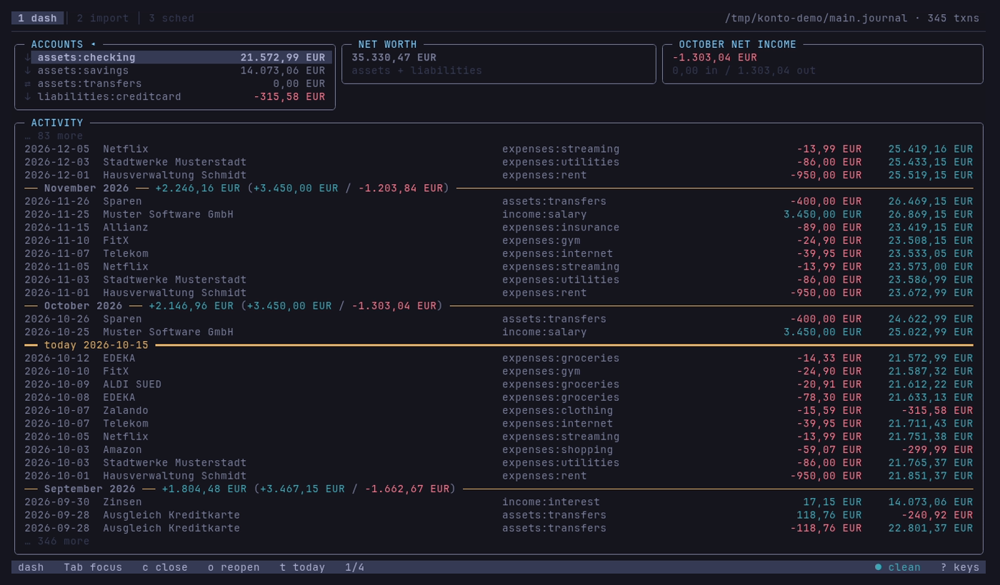
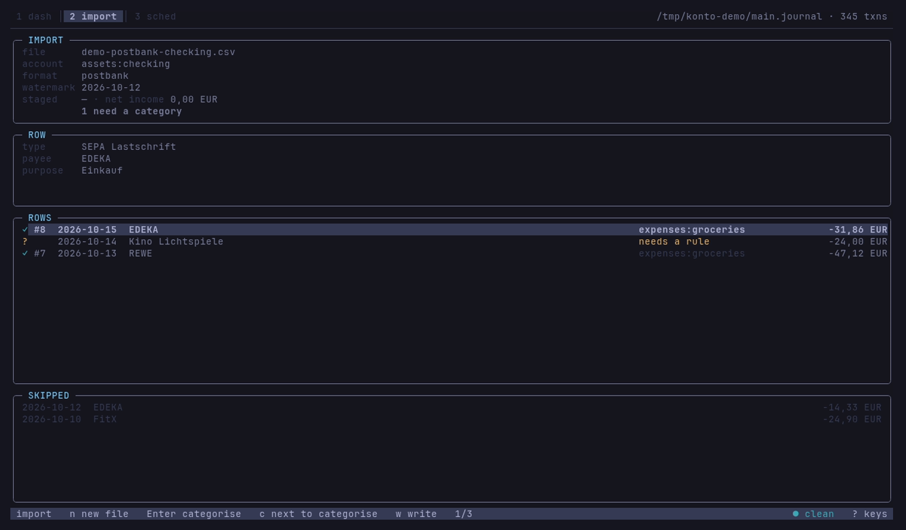
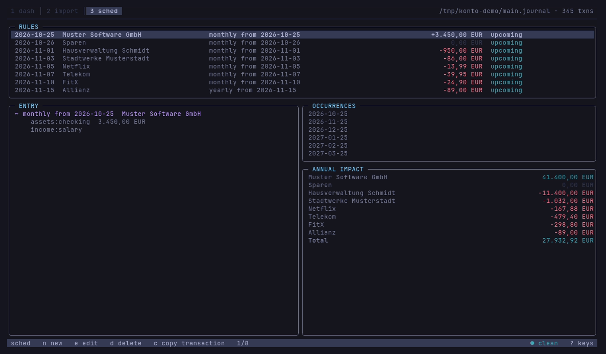
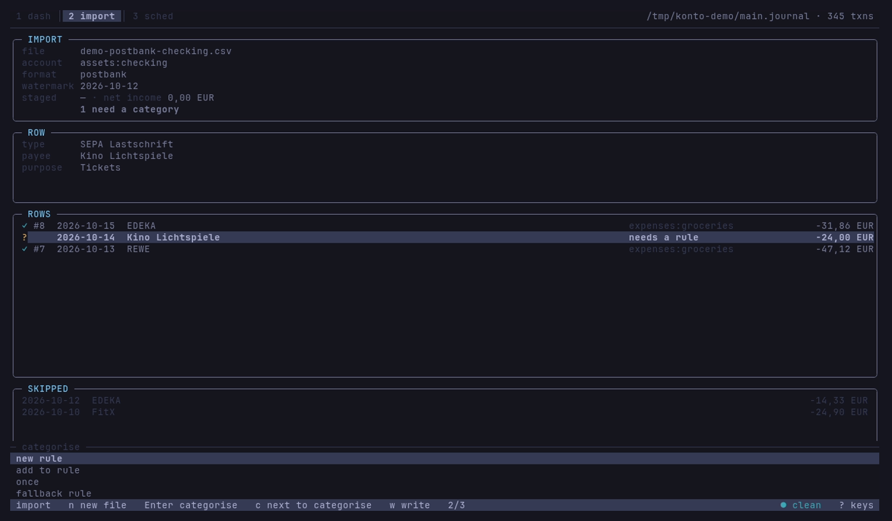

# konto

konto is a terminal user interface for [hledger](https://hledger.org). Use it to keep the
accounts of one person. konto reads and writes a plain-text hledger journal. hledger does all
the calculations. konto does not change how hledger works.

---

# Part 1: For users

## What konto does

konto has three views:

| Key | View | Function |
|---|---|---|
| `1` | Dashboard | Shows your accounts, your net worth and your net income for this month. Shows past and future transactions on one timeline. |
| `2` | Import | Reads a bank CSV file. Puts each row into a category. Writes the rows to the journal. |
| `3` | Scheduled | Shows the periodic rules (rent, salary, subscriptions). Lets you add, copy, edit and delete a rule. |

konto never writes a periodic rule as a transaction. A rule only shows the future payments.







## Try the demo

The `demo/` directory contains a demo ledger with fake data. Use it to see konto before you
use your own data. The demo has three bank accounts with transactions from July 2025 to
October 2026, periodic rules and one bank CSV file to import.

The demo data stops on 15 October 2026. konto shows the demo as if today is that date.

With [mise](https://mise.jdx.dev):

```sh
git clone https://github.com/sbradl/konto.git
cd konto
mise run demo
```

Without mise, copy the demo first. konto writes to the journal when you import or edit.

```sh
cp -r demo /tmp/konto-demo
KONTO_TODAY=2026-10-15 XDG_DOWNLOAD_DIR=/tmp/konto-demo/downloads \
  konto --file /tmp/konto-demo/main.journal
```

To see the import, push `2`, then `n`, then select `demo-postbank-checking.csv`.

## Requirements

- hledger 1.32 or later. The `hledger` command must be on your `PATH`.
- A terminal of 100 columns × 30 rows or larger.
- Go 1.27 or later, to install konto from source.

konto does a check of the hledger version when it starts. If hledger is missing or too old,
konto stops and shows a message.

## Install konto

1. Install hledger. Refer to <https://hledger.org/install.html>.
2. Install konto:

   ```sh
   go install github.com/sbradl/konto/cmd/konto@latest
   ```

3. Make sure that `$(go env GOPATH)/bin` is on your `PATH`.

## Start konto

Type:

```sh
konto
```

konto uses the first journal path that it finds in this sequence:

1. The `--file` option, for example `konto --file ~/finance/main.journal`.
2. The `LEDGER_FILE` environment variable.
3. The file `~/.hledger.journal`.

If the journal does not exist, konto asks you to create it. konto then writes a new journal
and an empty `categories.rules` file in the same directory.

Only one konto can use a journal at a time. If a second konto starts on the same journal, it
stops and shows a message.

## Files that konto writes

| File | Contents |
|---|---|
| The main journal | Settings, account declarations and periodic rules. |
| `YYYY.journal` | The transactions of one year, for example `2026.journal`. |
| `categories.rules` | The rules that put bank rows into categories. |

konto loads only this year and last year. The balances of older years go into the new year
as one carry transaction. The older files stay on the disk without change.

After each write, konto runs all hledger checks. If a check fails, konto does not write.

## Keys

All keys work from the keyboard. The mouse does not work.

| Where | Key | Function |
|---|---|---|
| All views | `1`, `2`, `3` | Go to a view. |
| | `↑` `↓` `PgUp` `PgDn` `Home` `End` | Move in a list. |
| | `?` | Show all keys. |
| | `!` | Show the results of the journal checks. |
| | `r` | Read the journal again. |
| | `Esc` | Cancel. Close a popup. |
| | `q`, `Ctrl+C` | Quit. |
| Dashboard | `Tab`, `Shift+Tab` | Move between the Accounts panel and the Activity panel. |
| | `t` | Go back to today on the Activity panel. |
| | `c` | Close the selected account. |
| | `o` | Open a closed account again. |
| Import | `n` | Open a new CSV file. |
| | `Enter` | Put the selected row into a category. |
| | `c` | Go to the next row without a category. |
| | `w` | Write the import to the journal. |
| Scheduled | `n` | Add a rule. |
| | `c` | Make a rule from a transaction. |
| | `e` | Edit the selected rule. |
| | `d` | Delete the selected rule. |
| Checks popup | `Enter` | Open the file at the problem line in your editor. |

Each action that writes to the journal asks for `y` or `n` first.

## Import a bank CSV file

konto reads Postbank CSV exports at this time.

1. Download the CSV file from your bank. konto looks for files in `$XDG_DOWNLOAD_DIR`. If
   that variable is not set, konto looks in `~/Downloads`.
2. Push `2` to go to the Import view.
3. Push `n` and select the file.
4. If the IBAN of the file is new, konto asks you to create an account for it.
5. konto shows each row. Rows that are already in the journal show in a list of skipped rows.
6. A row without a category shows `?`. Select the row and push `Enter`. Make a rule, add the
   row to a rule, or set the category one time.
7. Push `w` to write the import. konto writes only when all rows have a category.



konto adds a balance assertion with the closing balance of the bank file. If the balance in
the journal is different, hledger shows an error. Thus you see a missing or a wrong row
immediately.

An account gets its transactions from CSV imports only. A transfer between two of your
accounts goes through the clearing account `assets:transfers`.

## Close an account

1. Push `1` to go to the Dashboard.
2. Select the account and push `c`.
3. Push `y`.

konto closes only an account with a zero balance and with no periodic rule that uses it.
A closed account shows dim at the bottom of the list.

## Edit the journal manually

On the Checks popup (`!`), select a problem and push `Enter`. konto opens the file at that line
in `$VISUAL`. If `$VISUAL` is not set, konto uses `$EDITOR`. If neither is set, konto uses `vi`.
When the editor closes, konto reads the journal again.

---

# Part 2: For developers

## Read these documents first

| Document | Contents |
|---|---|
| [`docs/spec.md`](docs/spec.md) | The architecture: stack, layers, packages, hledger integration, domain model, UI composition, tests. |
| [`CONTEXT.md`](CONTEXT.md) | The glossary. Use these terms in code and in documents. |
| [`docs/adr/`](docs/adr/) | The decisions that are difficult to change. |
| [`features/`](features/) | The behaviour, as Gherkin scenarios. |

## Stack

- Go, with the Charm v2 libraries: `charm.land/bubbletea/v2`, `charm.land/lipgloss/v2`,
  `charm.land/bubbles/v2`. Do not use the `github.com/charmbracelet/.../v2` paths.
- The `hledger` binary. konto starts hledger as a separate process. konto does not parse
  journals, calculate balances or do checks itself.
- `internal/journal` is the only exception. It reads and writes a small number of journal
  lines that hledger cannot give in a machine format: `~` rules, `account` directive tags.

## Architecture

konto uses ports and adapters (ADR 0003). All dependencies point to `internal/domain`.

| Layer | Packages | Rule |
|---|---|---|
| Composition root | `cmd/konto` | Connects the adapters to the ports. |
| UI | `internal/ui`, `internal/ui/*` | Bubble Tea only here. A view does not import an adapter or another view. |
| Use cases | `internal/ledger`, `accounts`, `checks`, `carry`, `csvimport`, `periodic` | Each use case declares its own port interfaces. |
| Adapters | `internal/hledger`, `internal/journal` | Satisfy the ports structurally. |
| Domain | `internal/domain` | Types and rules. Imports nothing from konto. |

The tests in `internal/archtest` enforce these rules.

Colours are ANSI-16 indices (`"0"` to `"15"`). Do not use hex colours. All layouts change
with `tea.WindowSizeMsg`. Do not use fixed sizes.

## Set up the tools

[mise](https://mise.jdx.dev) installs the pinned tools: Go, golangci-lint, gotestsum,
gremlins, govulncheck, gitleaks, trivy, opengrep and hledger.

```sh
mise install
mise tasks        # list all tasks
```

## Tasks

| Task | Function |
|---|---|
| `mise run build` | Compiles all packages. |
| `mise run check` | Fast gate: build, vet, lint, architecture tests, unit tests with 100% coverage. |
| `mise run test` | Unit tests with the race detector. |
| `mise run test:integration` | Tests against the real hledger binary. |
| `mise run test:e2e` | Gherkin scenarios against the compiled binary on a pseudo-terminal. |
| `mise run mutation:diff` | Mutation tests on the changed lines. |
| `mise run security` | govulncheck, gitleaks, trivy (also licenses) and opengrep. |
| `mise run demo` | Starts konto on a copy of the demo ledger. |
| `mise run screenshots` | Makes the README screenshots again from the demo ledger. |
| `mise run qa` | All the steps that CI runs. |

Run one test:

```sh
go test -run 'TestName$' ./internal/pkg
```

Run the e2e scenarios with one tag:

```sh
mise run test:e2e -- -godog.tags=@spec-4.5
```

## Quality gates

- Coverage must be 100%.
- No mutant can survive.
- golangci-lint must show no issues.
- All security scans must pass.

The thresholds are at the maximum. Do not make a threshold lower without a written reason in
`mise.toml`.

## Add a bank file format

konto reads Postbank CSV exports at this time. A bank format is a layout description, not a
parser. konto uses the description for two tasks:

- konto reads the preamble of the export: the IBAN, the closing balance and the raw columns.
- konto writes an hledger rules file from the description. hledger converts the bookings.

Thus the two readings of the file always agree. Do not write a new CSV parser.

### Requirements for a format

The bank export must give this data:

- The IBAN of the account, in a fixed line and column above the bookings.
- The closing balance, in a trailer line or a preamble line. konto writes it as a balance
  assertion (ADR 0009).
- One line for each booking, with a date, a type, a payee, a purpose and an amount.
- One currency for all amounts.

If a bank export does not give the IBAN or the closing balance, discuss the change first. The
import rules depend on them.

### Procedure

1. Get a real export from the bank. Keep it in `.scratch/konto-spec/samples/`. Git ignores
   this directory. Do not commit a real export.
2. In `internal/csvimport/bankformat.go`, add a constant for the format name, for example
   `FormatComdirect = "comdirect"`. konto writes this name into the `konto:format:` tag of
   each account that it creates from an import.
3. Add a function that returns the `bankFormat` value of the bank. Use `postbank()` as the
   example. Set these fields:

   | Field | Contents |
   |---|---|
   | `skip` | The number of preamble lines above the header line. |
   | `header` | The start of the header line. konto finds the bookings with it. |
   | `trailer` | The first field of the line with the closing balance. |
   | `dateLayout`, `dateFormat` | The date format, as Go reads it and as hledger reads it. |
   | `decimalMark`, `groupMark` | For example `,` and `.` for German amounts. |
   | `ibanLine`, `ibanColumn` | The position of the IBAN. Lines and columns start at 0. |
   | `balanceColumn` | The column of the closing balance in the trailer line. |
   | `dateColumn` … `amountColumn` | The columns of the booking fields. |

4. Add the function to the list in `formatNamed`.
5. Make `Open` in `internal/csvimport/csvimport.go` find the format. At this time, `Open` uses
   `postbank()` directly. Try each format in sequence and use the first format whose header
   line is in the file. For an existing account, the format must agree with its
   `konto:format:` tag.
6. If the bank does not use `;` between the columns, change the `separator` constant into a
   field of `bankFormat`.

### Tests

1. Add unit tests in `internal/csvimport` for the preamble, the IBAN, the closing balance and
   the rules text.
2. Add an e2e export generator for the bank. Use `e2e/postbank_test.go` as the example. Use
   only fake data.
3. Add a feature file for the format mechanics. Use `features/import-format.feature` as the
   example.
4. Use the fake IBANs `DE00000000000000000001` to `DE00000000000000000099`. The pre-commit
   hook accepts them. The hook stops a real IBAN.

## Demo ledger and screenshots

`demo/` is the demo ledger. It uses only fake data and fake IBANs (`DE000…`). All hledger checks
pass on it. If you change konto's journal format, change the demo too.

`mise run screenshots` uses [VHS](https://github.com/charmbracelet/vhs) and the script
`docs/screenshots/demo.tape`. VHS needs `ffmpeg` and Chromium on your system. The task copies
the demo to `/tmp/konto-demo`, so no personal path shows in the images.

## Data safety

`.scratch/konto-spec/samples/` can contain real bank exports. Git ignores this directory.
Do not commit real bank data. Use the fixtures in `testdata/` for tests.

A pre-commit hook in `.githooks/` stops a commit that contains a secret or personal data. The
hook runs gitleaks with the rules in `.gitleaks.toml`:

- The default gitleaks rules for keys, tokens and passwords.
- IBANs. Fake and published example IBANs are on an allowlist.
- Bank export files, for example `Kontoumsaetze_*.csv`.
- Email addresses, except `example.com` and no-reply addresses.
- Paths into a real home directory, except `/home/alex` and `/home/me`.

`mise install` turns the hook on. You can also type `mise run hooks:install`.

If the hook stops a fake value, add the value to the allowlist of the rule. Do not add a real
value.

---

# License

konto is available under the [MIT License](LICENSE).

konto starts hledger as a separate program. hledger has its own license, the GPL-3.0.
